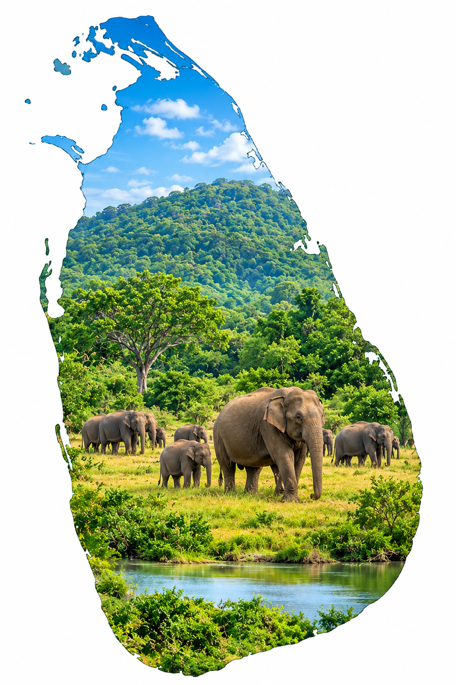
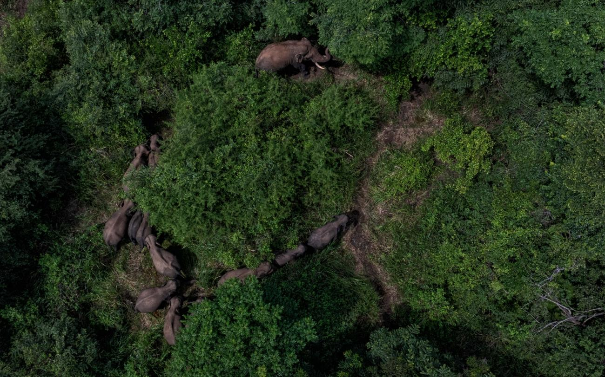

## {.title-split}

::: {.split}
::: {.left-title}
<p class="main-title">The Future of Animals is in Our Hands:<br> My Role as a Data Scientist in Wildlife Conservation</p>
<p class="author"><b>Thiyanga S. Talagala</b><br>University of Sri Jayewardenepura <br>Sri Lanka</p>
<p class="subtitle"><b>WOMBAT 2026</b><br>Melbourne, Australia</p>
:::

::: {.right-pic}

:::
:::

##

::: {.columns}

::: {.column width="55%"}

### Sri Lanka

- Total area: about 65,610 km²
- Human population: about 21.78 million
- Elephant population: 6,000–7,000

:::

::: {.column width="45%"}

{width="100%"}

:::

:::


```{r, echo=FALSE, message=FALSE, warning=FALSE}
library(tidyverse)
library(tsibble)
library(trackable)
library(here)
library(ggspatial)
library(gganimate)
```

# {background-image="conflicts.png" background-size="contain"}


## Understanding Elephants 

- Which forests, grasslands and protected areas do they inhabit?


- What are their home ranges?


- Which routes and corridors do they use?


- How far do they roam daily, weekly and seasonally?


- Do they move between forests and agricultural lands?


- Where do they go during wet and dry seasons?


- Do individual elephants and herds follow different roaming patterns?


- How do human settlements, roads and fences influence their roaming routes?

# Can we know where an elephant is right now, even when it is deep inside a forest?


# {background-image="elephantwithbelt.png" background-size="contain"}

# {background-image="GPS.png" background-size="contain"}

# {background-image="belt.png" background-size="contain"}


## Why can't we publish the actual GPS coordinates?

::: {.columns}

::: {.column width="55%"}


1. Elephant safety: Exact locations could be misused by poachers.

2. Sensitive habitats: Locations of important habitats, water sources, resting areas and migration corridors could be exploited.

:::

::: {.column width="45%"}

{width="100%"}

:::
:::

# Pinnawala Elephant Orphanage


```{r}
male <- read_csv(here("data/elephant_fixes_2025male.csv"))
male_tracks <- male |>
  mutate(elephant = recode(elephant, "E01" = "m1"))
female <- read_csv(here("data/elephant_fixes_2025female.csv"))
female_tracks <- female |>
  mutate(elephant = recode(elephant, "E01" = "f1"))
elephants <- bind_rows(
  male_tracks,
  female_tracks
)
```

## Data

```{r}
dt <- elephants |> select(elephant, datetime, lon, lat) |> head(6)
knitr::kable(dt)
```

## Other variables

| Dimension | Categories |
|:---|:---|
| Season | Wet, Dry |
| Time of day | Night, Pre-dawn, Morning, Midday, Afternoon, Evening |
| Behaviour | Sleeping, Foraging, Travelling, Resting, Bathing |
| Habitat | Grassland, Scrub, Riverine corridor, Dense forest, Cropland edge |

## Sleeping, foraging, travelling, resting, and bathing

```{r}
library(knitr)
library(kableExtra)
library(dplyr)
library(tibble)

library(tibble)
library(knitr)
library(kableExtra)

behaviour_df <- tribble(
  ~Behaviour, ~GPS_movement_characteristics,
  "Sleeping",
  "Very low or zero movement; long stationary bouts; mean duration: 180 minutes; more frequent at night.",
  "Foraging",
  "Slow movement; short distances between GPS fixes; frequent direction changes; localised feeding movements; speed factor: 0.4.",
  "Travelling",
  "High movement speed; directional movement; longer distances between GPS fixes; movement towards a selected target.",
  "Resting",
  "Almost zero movement; stationary GPS locations with minor positional variation; mean duration: 60 minutes.",
  "Bathing",
  "Movement towards the nearest riverine corridor; almost stationary at the river; movement may occur while approaching water."
)

kable(
  behaviour_df,
  col.names = c("Behaviour", "GPS movement characteristics and simulation rules"),
  align = c("l", "l"),
  format = "html",
  table.attr = 'style="width:100%; font-size:0.75em;"'
) %>%
  kable_styling(
    bootstrap_options = c("striped", "condensed"),
    full_width = TRUE,
    position = "left"
  ) %>%
  column_spec(1, bold = TRUE, width = "17%") %>%
  column_spec(2, width = "83%")
```


#  {background-image="ds1.png" background-size="contain"}

# {background-image="ds2.png" background-size="contain"}

## Elephant Rani at Pinnewela Elephant Orphanage

```{r}
library(dplyr)
library(lubridate)

rani <- pinnawala |>
  mutate(
    datetime = ymd_hm(paste("2026-10-12", time)),
    id = "Rani",
    location = "Pinnawala"
  ) %>%
  select(id, datetime, longitude, latitude, location)
rani
```

## `trackable`

```{r, echo=TRUE}
trkrani <- rani |> trackable(
 time = datetime,
 x = longitude, y = latitude,
 key = c("id"),
 crs = 4326)
trkrani
```

## 

```{r, warning=FALSE, message=FALSE, echo=TRUE}
#| out.width: "100%"
#| out.height: "100%"
ggplot() +
  annotation_map_tile(type = "osm", zoom = 16) +
  geom_sf(data = trkrani, col="red", size = 3) +
  geom_sf( data = sf::st_cast(sf::st_combine(trkrani),
      "LINESTRING"),colour = "black",
    linewidth = 0.7
  ) + theme_minimal()
```


## `trackable`

```{r, echo=TRUE}
trk_ele <- elephants |>
  trackable(
 time = datetime,
 x = lon, y = lat,
 key = c("elephant"), crs = 4326)
trk_ele
```

## Tracking data quality

`track_gaps()` — identify missing or unusually long intervals between observations.

`track_regularise()` — create a regular time index for each animal.

`track_interpolate()` — interpolate missing positions when scientifically appropriate.

`track_duplicates()` — detect duplicated timestamps or locations.

`track_outliers()` — flag implausible GPS fixes or speeds.

`track_validate()` — check identifiers, timestamps, coordinates, and ordering.
These are especially important before calculating movement metrics or fitting behavioural models.

## track validate

```{r, echo=TRUE}
track_validate(trk_ele)
```


## Udawalawa: Elephant Movement

```{r}
#| warnings: false
#| messages: false
#| fig.height: 8
#| fig.width: 15
library(ggplot2)
library(ggspatial)
library(sf)
library(maptiles)

# Define full park extent
park_extent <- st_bbox(
  c(
    xmin = 80.75,
    ymin = 6.4167,
    xmax = 81.00,
    ymax = 6.5833
  ),
  crs = st_crs(4326)
)

# Create spatial bounding box
park_area <- st_as_sfc(park_extent)

# Download OSM tiles for the entire area
osm <- get_tiles(
  park_area,
  provider = "OpenStreetMap",
  zoom = 13
)

# Plot elephant movement
ggplot() +
  layer_spatial(osm) +
  geom_path(
    data = trk_ele |> arrange(elephant, datetime),
    aes(x = lon, y = lat, colour = elephant),
    linewidth = 1,
    alpha=0.5
  ) +
  geom_point(
    data = trk_ele,
    aes(x = lon, y = lat, colour = elephant),
    size = 1.5,
    alpha=0.5
  ) +
  facet_wrap(~elephant) +
  labs(
    x = "Longitude",
    y = "Latitude",
    colour = "Elephant"
  ) +
  theme_minimal()

```

## Wet Period (January 2, December 12)

```{r}
library(dplyr)
library(ggplot2)
library(ggspatial)
library(sf)
library(maptiles)

# Select observations on the two dates
highlight_dates <- trk_ele |>
  mutate(date = as.Date(datetime)) |>
  filter(
    format(date, "%m-%d") %in% c("12-12", "01-02")
  ) |>
  mutate(
    highlight_date = case_when(
      format(date, "%m-%d") == "12-12" ~ "December 12",
      format(date, "%m-%d") == "01-02" ~ "January 2"
    )
  )

# Plot
ggplot() +
  layer_spatial(osm) +

  # All movement tracks in the background
  geom_path(
    data = trk_ele |> arrange(elephant, datetime),
    aes(lon, lat, group = elephant),
    colour = "grey50",
    linewidth = 0.7,
    alpha = 0.4
  ) +

  # Highlight selected dates
  geom_point(
    data = highlight_dates,
    aes(
      lon, lat,
      colour = highlight_date,
     # shape = behaviour
    ),
    size = 3,
    alpha = 0.9
  ) +

  facet_wrap(~elephant) +

  labs(
    x = "Longitude",
    y = "Latitude",
    colour = "Observation date",
    shape = "Behaviour"
  ) +
  theme_minimal()
```

## Wet Period (January 2, December 12)

```{r}
library(dplyr)
library(ggplot2)
library(ggspatial)
library(sf)
library(maptiles)

# Select observations on the two dates
highlight_dates <- trk_ele |>
  mutate(date = as.Date(datetime)) |>
  filter(
    format(date, "%m-%d") %in% c("12-12", "01-02")
  ) |>
  mutate(
    highlight_date = case_when(
      format(date, "%m-%d") == "12-12" ~ "December 12",
      format(date, "%m-%d") == "01-02" ~ "January 2"
    )
  )

# Plot
ggplot() +
  layer_spatial(osm) +

  # All movement tracks in the background
  # Highlight selected dates
  geom_point(
    data = highlight_dates,
    aes(
      lon, lat,
      colour = highlight_date,
     # shape = behaviour
    ),
    size = 3,
    alpha = 0.9
  ) +

  facet_wrap(~elephant) +

  labs(
    x = "Longitude",
    y = "Latitude",
    colour = "Observation date",
    shape = "Behaviour"
  ) +
  theme_minimal()
```


## Dry Period

```{r}
library(dplyr)
library(ggplot2)
library(ggspatial)
library(sf)
library(maptiles)

# Select observations on the two dates
highlight_dates <- trk_ele |>
  mutate(date = as.Date(datetime)) |>
  filter(
    format(date, "%m-%d") %in% c("04-12", "09-10")
  ) |>
  mutate(
    highlight_date = case_when(
      format(date, "%m-%d") == "04-12" ~ "May 12",
      format(date, "%m-%d") == "09-10" ~ "September 10"
    )
  )

# Plot
ggplot() +
  layer_spatial(osm) +

  # All movement tracks in the background
  geom_path(
    data = trk_ele |> arrange(elephant, datetime),
    aes(lon, lat, group = elephant),
    colour = "grey50",
    linewidth = 0.7,
    alpha = 0.4
  ) +

  # Highlight selected dates
  geom_point(
    data = highlight_dates,
    aes(
      lon, lat,
      colour = highlight_date,
     # shape = behaviour
    ),
    size = 3,
    alpha = 0.9
  ) +

  facet_wrap(~elephant) +

  labs(
    x = "Longitude",
    y = "Latitude",
    colour = "Observation date",
    shape = "Behaviour"
  ) +
  theme_minimal()
```

## Dry Period

```{r}
library(dplyr)
library(ggplot2)
library(ggspatial)
library(sf)
library(maptiles)

# Select observations on the two dates
highlight_dates <- trk_ele |>
  mutate(date = as.Date(datetime)) |>
  filter(
    format(date, "%m-%d") %in% c("04-12", "09-10")
  ) |>
  mutate(
    highlight_date = case_when(
      format(date, "%m-%d") == "04-12" ~ "May 12",
      format(date, "%m-%d") == "09-10" ~ "September 10"
    )
  )

# Plot
ggplot() +
  layer_spatial(osm) +

  # All movement tracks in the background
  geom_path(
    data = trk_ele |> arrange(elephant, datetime),
    aes(lon, lat, group = elephant),
    colour = "NA",
    linewidth = 0.7,
    alpha = 0.4
  ) +

  # Highlight selected dates
  geom_point(
    data = highlight_dates,
    aes(
      lon, lat,
      colour = highlight_date,
     # shape = behaviour
    ),
    size = 3,
    alpha = 0.9
  ) +

  facet_wrap(~elephant) +

  labs(
    x = "Longitude",
    y = "Latitude",
    colour = "Observation date",
    shape = "Behaviour"
  ) +
  theme_minimal()
```


## Movement metrics: `movement_metrics`

```{r}
movement_variables <- tibble::tribble(
  ~Variable, ~Description, ~Unit_or_Type,
  "x_km", "Projected X-coordinate representing the animal's east–west location.", "Kilometres",
  "y_km", "Projected Y-coordinate representing the animal's north–south location.", "Kilometres",
  "step_km", "Distance travelled between consecutive GPS locations.", "Kilometres",
  "speed_kmh", "Movement speed between consecutive GPS observations.", "Kilometres/hour",
  "geometry", "Spatial geometry representing the animal's geographic location.", "sf geometry",
  "elapsed_time_s", "Time elapsed between consecutive GPS observations.", "Seconds",
  "step_distance_m", "Geographic distance travelled between consecutive GPS locations.", "Metres",
  "speed_m_s", "Movement speed between consecutive GPS observations.", "Metres/second",
  "bearing_deg", "Compass direction of movement from the previous location to the current location.", "Degrees (0–360)",
  "turn_angle_deg", "Change in direction between consecutive movement steps.", "Degrees (-180 to 180)",
  "cumulative_distance_m", "Total distance travelled since the first recorded observation.", "Metres",
  "displacement_m", "Straight-line distance from the first recorded location to the current location.", "Metres"
)

knitr::kable(
  movement_variables,
  col.names = c("Variable", "Description", "Unit / Type"),
  caption = "Spatial and movement variables in a trackable object"
)
```


##

```{r, echo=TRUE}
movmat <- movement_metrics(
    trk_ele,
    id = "elephant",
    time = "datetime",
    lon = "lon",
    lat = "lat")
movmat |> select(1, 3,  18:24) 
```

##

```{r}
movmat |> select(1, 3,  18:24) |> knitr::kable()
```

##

```{r}
ggplot(movmat, aes(x = step_km, fill = behaviour)) +
  geom_histogram(
    bins = 30,
    na.rm = TRUE,
    colour = "white",
    alpha = 0.7,
    position = "identity"
  ) +
  #scale_x_log10() +
  labs(
    title = "Distribution of Step Lengths by Behaviour",
    x = "Step length (km)",
    y = "Frequency",
    fill = "Behaviour"
  ) +
  theme_bw()
```

##

```{r}
ggplot(movmat, aes(x = step_km, fill = behaviour)) +
  geom_histogram(
    bins = 30,
    na.rm = TRUE,
    colour = "white",
    alpha = 0.7,
    position = "identity"
  ) +
  scale_x_log10() +
  labs(
    title = "Distribution of Step Lengths by Behaviour",
    x = "Step length (km, log scale)",
    y = "Frequency",
    fill = "Behaviour"
  ) +
  theme_bw()
```


## Track activity

Calculate movement summaries for specified temporal intervals.

```{r, echo=TRUE}
activity <- track_activity(trk_ele, by = "month") 
activity
```


## 

```{r}
library(ggplot2)
library(dplyr)

activity %>%
  ggplot(aes(
    x = period,
    y = total_distance_m,
    colour = elephant,
    group = elephant
  )) +
  geom_line(linewidth = 1) +
  geom_point(size = 2.5) +
  scale_x_datetime(
    date_labels = "%b",
    date_breaks = "1 month"
  ) +
  scale_y_continuous(
    labels = scales::label_comma()
  ) +
  labs(
    title = "Monthly Variation in Elephant Movement Distance",
    x = "Month",
    y = "Total distance travelled (m)",
    colour = "Elephant"
  ) +
  theme_minimal(base_size = 13) +
  theme(
    legend.position = "top",
    axis.text.x = element_text(angle = 45, hjust = 1)
  )
```

# Home range 

`track_hull()` — calculate a convex hull around observed locations.

`track_home_range()` — estimate a home range using methods such as kernel density estimation.

`track_utilization_distribution()` — estimate the relative intensity of space use.

`track_overlap()` — quantify spatial overlap between animals or groups.

`track_residence_time()` — estimate how long an animal stays within a defined area.

`track_crossings()` — identify river, road, or habitat-boundary crossings.

## 

```{r, echo=TRUE}
library(sf)
library(dplyr)
hulls <- track_hull(trk_ele, method = "convex")
hull_area <- hulls %>%
  mutate(
    area_km2 = as.numeric(st_area(geometry)) / 1e6
  ) %>%
  st_drop_geometry()
hull_area
```

## 

```{r}
library(ggplot2)
ggplot() +
  geom_sf(
    data = hulls,
    aes(fill = elephant),
    alpha = 0.3,
    colour = "black"
  ) +
  geom_sf(
    data = trk_ele,
    aes(colour = elephant),
    size = 0.3,
    alpha = 0.5
  ) +
  labs(
    title = "Overall Home Range (Convex Hull)",
    fill = "Elephant",
    colour = "Elephant"
  ) +
  theme_minimal()
```

## Monthly home range (monthly convex hull)

```{r}
track_hull(
  trk_ele,
  method = "convex",
  by = c("elephant", "month")
)
```

##

```{r}
library(ggplot2)
library(sf)

hulls_monthly <- track_hull(
  trk_ele,
  method = "convex",
  by = c("elephant", "month")
)

hulls_monthly <- hulls_monthly |>
  mutate(
    month = factor(month, levels = 1:12, labels = month.abb)
  )
hulls_monthly
```

##

```{r}
ggplot(hulls_monthly) +
  geom_sf(
    aes(fill = elephant),
    alpha = 0.35,
    colour = "black",
    linewidth = 0.3
  ) +
  facet_wrap(~ month, ncol = 6) +
  scale_fill_manual(
    values = c("f1" = "#E76F51", "m1" = "#2878B5"),
    labels = c("f1" = "Female", "m1" = "Male")
  ) +
  labs(
    title = "Monthly Home Range (Monthly Convex Hull)",
    fill = "Sex"
  ) +
  theme_minimal() +
  theme(
    legend.position = "top",
    strip.text = element_text(face = "bold"),
    panel.grid = element_line(colour = "grey90")
  )
```

## Behaviour and activity patterns

`track_stop()` — detect periods of low movement.

`track_bursts()` — identify rapid movement episodes.

`track_activity()` — summarise movement by hour, day, or season.

`track_day_night()` — compare daytime and nighttime movement.

`track_behaviour()` — classify movement into candidate behavioural states.

`track_seasonality()` — examine seasonal differences in movement.

## Detect stopping periods lasting at least 2 hours

```{r, echo=TRUE}
stops_2h <- track_stop(
  trk_ele,
  speed_threshold = 0.2,
  min_duration = 7200,
  radius = 50
)
stops_2h
```

##

```{r, eval=FALSE, echo=TRUE}
stops_2h <- track_stop(
  trk_ele,
  speed_threshold = 0.2,
  min_duration = 7200,
  radius = 50
)
stops_2h
```

`speed_threshold` = 0.2	The elephant's movement speed must be at or below 0.2 (in the speed unit used by the function, e.g. m/s).

`min_duration` = 7200	A stopping period must last at least 7,200 seconds (2 hours).

`radius` = 50	GPS locations during the stopping period must remain within a 50 m radius.

```{r, eval=FALSE, echo=TRUE}
stops_2h <- track_stop(
  trk_ele,
  speed_threshold = 0.2,
  min_duration = 7200,
  radius = 50
)
stops_2h
```

## 


