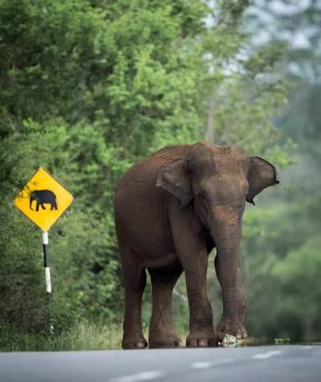

## {.title-split}

::: {.split}
::: {.left-title}
<p class="main-title">The Future of Animals is in Our Hands:<br> My Role as a Data Scientist in Wildlife Conservation</p>
<p class="author"><b>Thiyanga S. Talagala</b><br>University of Sri Jayewardenepura <br>Sri Lanka</p>
<p class="subtitle"><b>WOMBAT 2026</b><br>Melbourne, Australia</p>
:::

::: {.right-pic}

:::
:::

##

::: {.columns}

::: {.column width="55%"}

### Sri Lanka

- Total area: about 65,610 km²
- Human population: about 21.78 million
- Elephant population: 6,000–7,000

:::

::: {.column width="45%"}

{width="100%"}

:::

:::


```{r, echo=FALSE, message=FALSE, warning=FALSE}
library(tidyverse)
library(tsibble)
library(trackable)
library(here)
library(ggspatial)
library(gganimate)
```

# {background-image="conflicts.png" background-size="contain"}


## Understanding Elephants 

- Which forests, grasslands and protected areas do they inhabit?


- What are their home ranges?


- Which routes and corridors do they use?


- How far do they roam daily, weekly and seasonally?


- Do they move between forests and agricultural lands?


- Where do they go during wet and dry seasons?


- Do individual elephants and herds follow different roaming patterns?


- How do human settlements, roads and fences influence their roaming routes?

# Can we know where an elephant is right now, even when it is deep inside a forest?


# {background-image="elephantwithbelt.png" background-size="contain"}

# {background-image="GPS.png" background-size="contain"}

# {background-image="belt.png" background-size="contain"}


## Why can't we publish the actual GPS coordinates?

::: {.columns}

::: {.column width="55%"}


1. Elephant safety: Exact locations could be misused by poachers.

2. Sensitive habitats: Locations of important habitats, water sources, resting areas and migration corridors could be exploited.

:::

::: {.column width="45%"}

{width="100%"}

:::
:::

# Pinnawala Elephant Orphanage


```{r}
male <- read_csv(here("data/elephant_fixes_2025male.csv"))
male_tracks <- male |>
  mutate(elephant = recode(elephant, "E01" = "m1"))
female <- read_csv(here("data/elephant_fixes_2025female.csv"))
female_tracks <- female |>
  mutate(elephant = recode(elephant, "E01" = "f1"))
elephants <- bind_rows(
  male_tracks,
  female_tracks
)
```

## Data

```{r}
dt <- elephants |> select(elephant, datetime, lon, lat) |> head(6)
knitr::kable(dt)
```

## Other variables

| Dimension | Categories |
|:---|:---|
| Season | Wet, Dry |
| Time of day | Night, Pre-dawn, Morning, Midday, Afternoon, Evening |
| Behaviour | Sleeping, Foraging, Travelling, Resting, Bathing |
| Habitat | Grassland, Scrub, Riverine corridor, Dense forest, Cropland edge |

##

<div style="font-size: 0.75em;">

<table style="width:100%; border-collapse:collapse;">

<thead>
<tr style="background-color:#081d58; color:white;">
<th style="width:20%; padding:10px; text-align:left;">Behaviour</th>
<th style="padding:10px; text-align:left;">GPS movement characteristics and simulation rules</th>
</tr>
</thead>

<tbody>

<tr>
<td style="padding:10px; vertical-align:top;"><strong>Sleeping</strong></td>
<td style="padding:10px;">
<ul>
<li>Very low or zero movement</li>
<li>Long-duration stationary bouts</li>
<li>Mean bout duration: <strong>180 minutes</strong></li>
<li>More frequent during the night</li>
</ul>
</td>
</tr>

<tr style="background:#edf2f7;">
<td style="padding:10px; vertical-align:top;"><strong>Foraging</strong></td>
<td style="padding:10px;">
<ul>
<li>Relatively slow movement</li>
<li>Short distances between consecutive GPS fixes</li>
<li>Frequent changes in direction</li>
<li>Localised movements around feeding locations</li>
<li>Speed factor: <strong>0.4</strong></li>
</ul>
</td>
</tr>

<tr>
<td style="padding:10px; vertical-align:top;"><strong>Travelling</strong></td>
<td style="padding:10px;">
<ul>
<li>Relatively high movement speed</li>
<li>More directional movement</li>
<li>Longer distances between GPS fixes</li>
<li>Movement towards a selected target location</li>
</ul>
</td>
</tr>

<tr style="background:#edf2f7;">
<td style="padding:10px; vertical-align:top;"><strong>Resting</strong></td>
<td style="padding:10px;">
<ul>
<li>Almost zero movement</li>
<li>Stationary GPS locations with minor positional variation</li>
<li>Mean bout duration: <strong>60 minutes</strong></li>
</ul>
</td>
</tr>

<tr>
<td style="padding:10px; vertical-align:top;"><strong>Bathing</strong></td>
<td style="padding:10px;">
<ul>
<li>Movement towards the nearest riverine corridor</li>
<li>Almost stationary once at the river</li>
<li>Movement may occur while approaching the water</li>
</ul>
</td>
</tr>

</tbody>
</table>

</div>

<div style="font-size:0.55em; color:#777; margin-top:8px;">
Note: These are behavioural rules used in the simulation. GPS movement patterns alone cannot confirm actual elephant behaviour.
</div>

## Motivation for the work

```{r}
library(tibble)
library(tsibble)
library(sf)
library(knitr)

df <- tibble(
  Feature = c(
    "Tabular data",
    "Create data manually",
    "Animal identification",
    "Store timestamps",
    "Time index",
    "Key-based observations",
    "Time-aware operations",
    "Geographic coordinates",
    "Spatial geometry",
    "Coordinate reference system (CRS)",
    "Spatial operations",
    "Represent movement trajectories",
    "Calculate movement distances",
    "Spatial joins",
    "Temporal aggregation"
  ),
  tibble = c(
    "Yes", "Yes", "Yes", "Yes", "No",
    "No", "No", "Yes", "No", "No",
    "No", "No", "No", "No", "Yes"
  ),
  tsibble = c(
    "Yes", "Yes", "Yes", "Yes", "Yes",
    "Yes", "Yes", "Yes", "No", "No",
    "No", "No", "No", "No", "Yes"
  ),
  sf = c(
    "Yes", "Yes", "Yes", "Yes", "No",
    "No", "No", "Yes", "Yes", "Yes",
    "Yes", "Yes", "Yes", "Yes", "No"
  )
)

knitr::kable(
  df,
  align = "lccc"
)
```

## `trackable`

```{r}
trk_ele <- elephants |>
  trackable(
 time = datetime,
  x = lon,
  y = lat,
 key = c("elephant"),
  crs = 4326)
trk_ele
```

## track validate

```{r}
track_validate(trk_ele)
```


##

```{r}
#| warnings: false
#| messages: false
#| fig.height: 8
#| fig.width: 15
library(ggplot2)
library(ggspatial)
library(sf)
library(maptiles)

# Define full park extent
park_extent <- st_bbox(
  c(
    xmin = 80.75,
    ymin = 6.4167,
    xmax = 81.00,
    ymax = 6.5833
  ),
  crs = st_crs(4326)
)

# Create spatial bounding box
park_area <- st_as_sfc(park_extent)

# Download OSM tiles for the entire area
osm <- get_tiles(
  park_area,
  provider = "OpenStreetMap",
  zoom = 13
)

# Plot elephant movement
ggplot() +
  layer_spatial(osm) +
  geom_path(
    data = trk_ele |> arrange(elephant, datetime),
    aes(x = lon, y = lat, colour = elephant),
    linewidth = 1,
    alpha=0.5
  ) +
  geom_point(
    data = trk_ele,
    aes(x = lon, y = lat, colour = elephant),
    size = 1.5,
    alpha=0.5
  ) +
  facet_wrap(~elephant) +
  labs(
    title = "Elephant Movement Patterns",
    x = "Longitude",
    y = "Latitude",
    colour = "Elephant"
  ) +
  theme_minimal()

```

## Wet Period (January 2, December 12)

```{r}
library(dplyr)
library(ggplot2)
library(ggspatial)
library(sf)
library(maptiles)

# Select observations on the two dates
highlight_dates <- trk_ele |>
  mutate(date = as.Date(datetime)) |>
  filter(
    format(date, "%m-%d") %in% c("12-12", "01-02")
  ) |>
  mutate(
    highlight_date = case_when(
      format(date, "%m-%d") == "12-12" ~ "December 12",
      format(date, "%m-%d") == "01-02" ~ "January 2"
    )
  )

# Plot
ggplot() +
  layer_spatial(osm) +

  # All movement tracks in the background
  geom_path(
    data = trk_ele |> arrange(elephant, datetime),
    aes(lon, lat, group = elephant),
    colour = "grey50",
    linewidth = 0.7,
    alpha = 0.4
  ) +

  # Highlight selected dates
  geom_point(
    data = highlight_dates,
    aes(
      lon, lat,
      colour = highlight_date,
     # shape = behaviour
    ),
    size = 3,
    alpha = 0.9
  ) +

  facet_wrap(~elephant) +

  labs(
    title = "Elephant Movement and Behaviour",
    subtitle = "Highlighted observations: December 12 and January 2",
    x = "Longitude",
    y = "Latitude",
    colour = "Observation date",
    shape = "Behaviour"
  ) +
  theme_minimal()
```

## Wet Period

```{r}
library(dplyr)
library(ggplot2)
library(ggspatial)
library(sf)
library(maptiles)

# Select observations on the two dates
highlight_dates <- trk_ele |>
  mutate(date = as.Date(datetime)) |>
  filter(
    format(date, "%m-%d") %in% c("12-12", "01-02")
  ) |>
  mutate(
    highlight_date = case_when(
      format(date, "%m-%d") == "12-12" ~ "December 12",
      format(date, "%m-%d") == "01-02" ~ "January 2"
    )
  )

# Plot
ggplot() +
  layer_spatial(osm) +

  # All movement tracks in the background
  geom_path(
    data = trk_ele |> arrange(elephant, datetime),
    aes(lon, lat, group = elephant),
    colour = "grey50",
    linewidth = 0.7,
    alpha = 0.4
  ) +

  # Highlight selected dates
  geom_point(
    data = highlight_dates,
    aes(
      lon, lat,
      colour = highlight_date,
     # shape = behaviour
    ),
    size = 3,
    alpha = 0.9
  ) +

  facet_wrap(~elephant) +

  labs(
    title = "Elephant Movement and Behaviour",
    subtitle = "Highlighted observations: December 12 and January 2",
    x = "Longitude",
    y = "Latitude",
    colour = "Observation date",
    shape = "Behaviour"
  ) +
  theme_minimal()
```

## Wet Period

```{r}
library(dplyr)
library(ggplot2)
library(ggspatial)
library(sf)
library(maptiles)

# Select observations on the two dates
highlight_dates <- trk_ele |>
  mutate(date = as.Date(datetime)) |>
  filter(
    format(date, "%m-%d") %in% c("12-12", "01-02")
  ) |>
  mutate(
    highlight_date = case_when(
      format(date, "%m-%d") == "12-12" ~ "December 12",
      format(date, "%m-%d") == "01-02" ~ "January 2"
    )
  )

# Plot
ggplot() +
  layer_spatial(osm) +

  # All movement tracks in the background
  geom_path(
    data = trk_ele |> arrange(elephant, datetime),
    aes(lon, lat, group = elephant),
    colour = NA,
    linewidth = 0.7,
    alpha = 0.4
  ) +

  # Highlight selected dates
  geom_point(
    data = highlight_dates,
    aes(
      lon, lat,
      colour = highlight_date,
     # shape = behaviour
    ),
    size = 3,
    alpha = 0.9
  ) +

  facet_wrap(~elephant) +

  labs(
    title = "Elephant Movement and Behaviour",
    subtitle = "Highlighted observations: December 12 and January 2",
    x = "Longitude",
    y = "Latitude",
    colour = "Observation date",
    shape = "Behaviour"
  ) +
  theme_minimal()
```


## Dry Period

```{r}
library(dplyr)
library(ggplot2)
library(ggspatial)
library(sf)
library(maptiles)

# Select observations on the two dates
highlight_dates <- trk_ele |>
  mutate(date = as.Date(datetime)) |>
  filter(
    format(date, "%m-%d") %in% c("04-12", "09-10")
  ) |>
  mutate(
    highlight_date = case_when(
      format(date, "%m-%d") == "04-12" ~ "May 12",
      format(date, "%m-%d") == "09-10" ~ "September 10"
    )
  )

# Plot
ggplot() +
  layer_spatial(osm) +

  # All movement tracks in the background
  geom_path(
    data = trk_ele |> arrange(elephant, datetime),
    aes(lon, lat, group = elephant),
    colour = "grey50",
    linewidth = 0.7,
    alpha = 0.4
  ) +

  # Highlight selected dates
  geom_point(
    data = highlight_dates,
    aes(
      lon, lat,
      colour = highlight_date,
     # shape = behaviour
    ),
    size = 3,
    alpha = 0.9
  ) +

  facet_wrap(~elephant) +

  labs(
    title = "Elephant Movement and Behaviour",
    subtitle = "Highlighted observations: April 12 and September 10",
    x = "Longitude",
    y = "Latitude",
    colour = "Observation date",
    shape = "Behaviour"
  ) +
  theme_minimal()
```

## Dry Period

```{r}
library(dplyr)
library(ggplot2)
library(ggspatial)
library(sf)
library(maptiles)

# Select observations on the two dates
highlight_dates <- trk_ele |>
  mutate(date = as.Date(datetime)) |>
  filter(
    format(date, "%m-%d") %in% c("04-12", "09-10")
  ) |>
  mutate(
    highlight_date = case_when(
      format(date, "%m-%d") == "04-12" ~ "May 12",
      format(date, "%m-%d") == "09-10" ~ "September 10"
    )
  )

# Plot
ggplot() +
  layer_spatial(osm) +

  # All movement tracks in the background
  geom_path(
    data = trk_ele |> arrange(elephant, datetime),
    aes(lon, lat, group = elephant),
    colour = "NA",
    linewidth = 0.7,
    alpha = 0.4
  ) +

  # Highlight selected dates
  geom_point(
    data = highlight_dates,
    aes(
      lon, lat,
      colour = highlight_date,
     # shape = behaviour
    ),
    size = 3,
    alpha = 0.9
  ) +

  facet_wrap(~elephant) +

  labs(
    title = "Elephant Movement and Behaviour",
    subtitle = "Highlighted observations: April 12 and September 10",
    x = "Longitude",
    y = "Latitude",
    colour = "Observation date",
    shape = "Behaviour"
  ) +
  theme_minimal()
```


## Summary

```{r}
movmat <- movement_metrics(
    trk_ele,
    id = "elephant",
    time = "datetime",
    lon = "lon",
    lat = "lat")
movmat |> select(1, 3,  18:24)
```


##

```{r}
ggplot(movmat, aes(x = step_km)) +
  geom_histogram(bins = 30, na.rm = TRUE) +
  scale_x_log10() +
  facet_grid( elephant~season, scales = "free_y") +
  labs(x = "Hourly step length (km, log scale)", y = "Count") +
  theme_bw()
```


##


```{r}
ggplot(movmat, aes(x = step_km)) +
  geom_histogram(bins = 30, na.rm = TRUE) +
  scale_x_log10() +
  facet_grid( elephant~behaviour, scales = "free_y") +
  labs(x = "Hourly step length (km, log scale)", y = "Count") +
  theme_bw()
```

## Track activity

```{r}
activity <- track_activity(trk_ele, by = "month") 
activity
```


## 

```{r}
library(ggplot2)
library(dplyr)

activity %>%
  ggplot(aes(
    x = period,
    y = total_distance_m,
    colour = elephant,
    group = elephant
  )) +
  geom_line(linewidth = 1) +
  geom_point(size = 2.5) +
  scale_x_datetime(
    date_labels = "%b",
    date_breaks = "1 month"
  ) +
  scale_y_continuous(
    labels = scales::label_comma()
  ) +
  labs(
    title = "Monthly Variation in Elephant Movement Distance",
    x = "Month",
    y = "Total distance travelled (m)",
    colour = "Elephant"
  ) +
  theme_minimal(base_size = 13) +
  theme(
    legend.position = "top",
    axis.text.x = element_text(angle = 45, hjust = 1)
  )
```


## 

```{r}
library(sf)
library(dplyr)

hulls <- track_hull(trk_ele, method = "convex")

hull_area <- hulls %>%
  mutate(
    area_km2 = as.numeric(st_area(geometry)) / 1e6
  ) %>%
  st_drop_geometry()

hull_area
```

## 

```{r}
library(ggplot2)

ggplot() +
  geom_sf(
    data = hulls,
    aes(fill = elephant),
    alpha = 0.3,
    colour = "black"
  ) +
  geom_sf(
    data = trk_ele,
    aes(colour = elephant),
    size = 0.3,
    alpha = 0.5
  ) +
  labs(
    title = "Elephant Home Range: Convex Hull",
    fill = "Elephant",
    colour = "Elephant"
  ) +
  theme_minimal()
```

## group by month

```{r}
track_hull(
  trk_ele,
  method = "convex",
  by = c("elephant", "month")
)
```

##

```{r}
library(ggplot2)
library(sf)

hulls_monthly <- track_hull(
  trk_ele,
  method = "convex",
  by = c("elephant", "month")
)

hulls_monthly <- hulls_monthly |>
  mutate(
    month = factor(month, levels = 1:12, labels = month.abb)
  )
hulls_monthly
```

##

```{r}
ggplot(hulls_monthly) +
  geom_sf(
    aes(fill = elephant),
    alpha = 0.35,
    colour = "black",
    linewidth = 0.3
  ) +
  facet_wrap(~ month, ncol = 6) +
  scale_fill_manual(
    values = c("f1" = "#E76F51", "m1" = "#2878B5"),
    labels = c("f1" = "Female", "m1" = "Male")
  ) +
  labs(
    title = "Monthly Elephant Movement Extent",
    subtitle = "Monthly Minimum Convex Polygons (MCP)",
    fill = "Sex"
  ) +
  theme_minimal() +
  theme(
    legend.position = "top",
    strip.text = element_text(face = "bold"),
    panel.grid = element_line(colour = "grey90")
  )
```

## 

```{r}
track_stop(trk_ele)
```

## 

```{r, eval=FALSE}

# Use existing elephant movement data
elephant_tracks <- trk_ele

# Detect stopping periods using default settings
stops <- track_stop(elephant_tracks)

# Display detected stopping periods
print(stops)

# Detect stopping periods lasting at least 2 hours
stops_2h <- track_stop(
  elephant_tracks,
  speed_threshold = 0.2,
  min_duration = 7200,
  radius = 50
)

# Detect stopping periods using stricter criteria
stops_restricted <- track_stop(
  elephant_tracks,
  speed_threshold = 0.1,
  min_duration = 3600,
  radius = 30
)

# Number of stopping periods per elephant
stops |>
  dplyr::count(elephant, name = "n_stops")

# Summarise stopping duration
stops |>
  dplyr::group_by(elephant) |>
  dplyr::summarise(
    n_stops = dplyr::n(),
    mean_duration_hours = mean(duration) / 3600,
    total_stopping_hours = sum(duration) / 3600,
    .groups = "drop"
  )

```